**Every batch carries its twin.** A twin is born with each batch at the field scale, grows with every reading, and seals into the claim.

[Protocol](https://fairfooddata.org/protocol.html) · [Method](https://fairfooddata.org/method.html) · [The batch](https://fairfooddata.org/registry.html) · [fairfooddata.org](https://fairfooddata.org)

## Repositories

| Repository | What it is | Status |
|---|---|---|
| [**twin-page**](https://github.com/FFD-Labs/twin-page) | The page a bag opens. A visitor scans the QR code on a bag of freeze-dried fruit, and their own device reads the bag's records from Ethereum and Swarm and checks them. No server in between. One HTML file, published with its hash. | In progress, for Devcon 8 (Mumbai, 2 to 6 November 2026). Apache 2.0. |
| [**BDF**](https://github.com/FFD-Labs/BDF) | The Bio-Digital Footprint protocol on Swarm, as a demo. The sensor data of one lot through harvest, transport and drying: each phase is encoded as BeeSon, uploaded to a Bee node and anchored on a Swarm feed. | Demo, April 2026. |
| [**BDF-smart-contracts**](https://github.com/FFD-Labs/BDF-smart-contracts) | The on-chain side of that demo, on Sepolia. One token per batch of raw product and one per retail package, each pointing at its records on Swarm, and the operator console that runs the path from harvest to packaging. | Demo, April 2026. |
